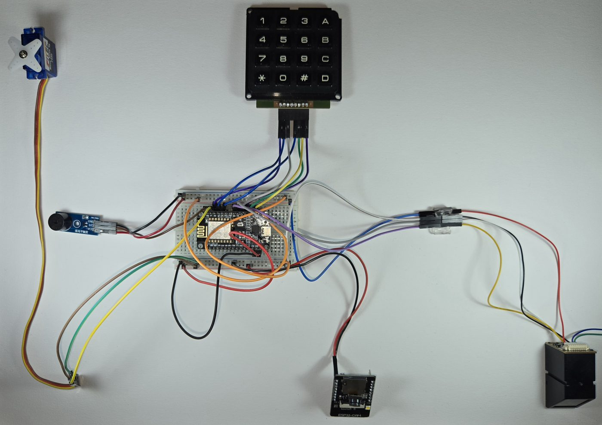
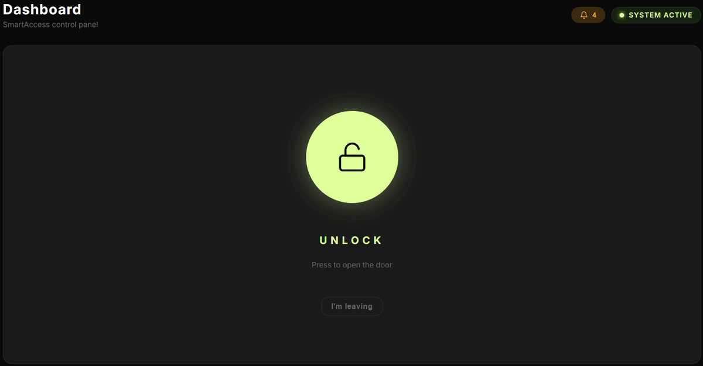
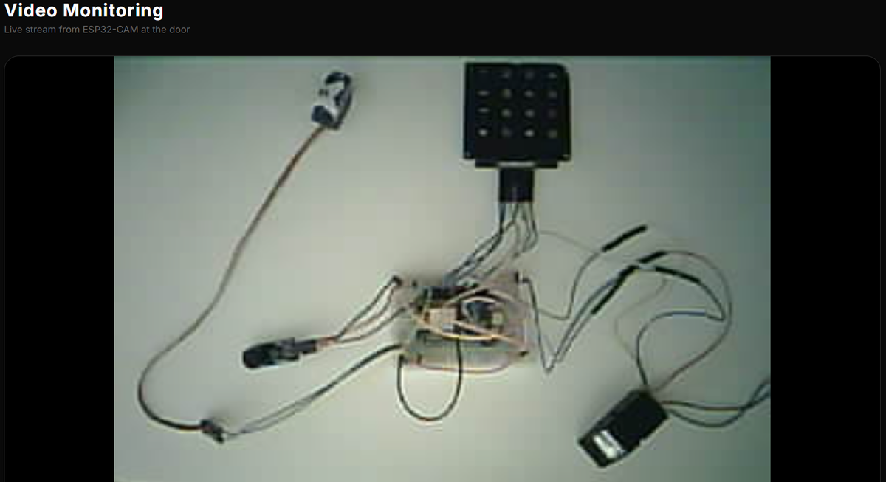
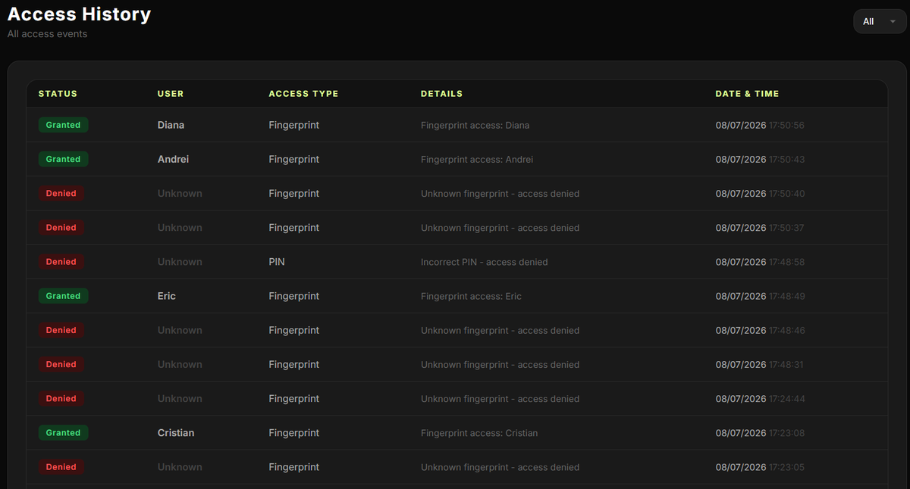
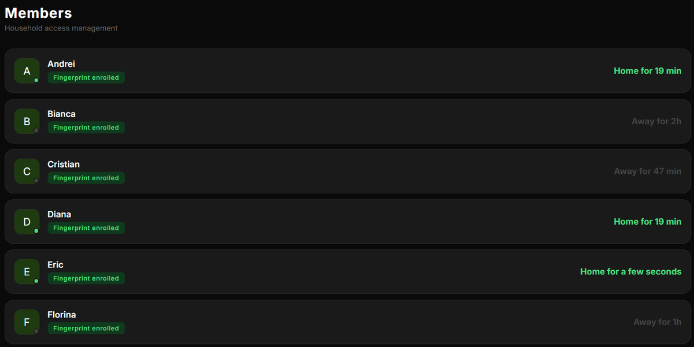
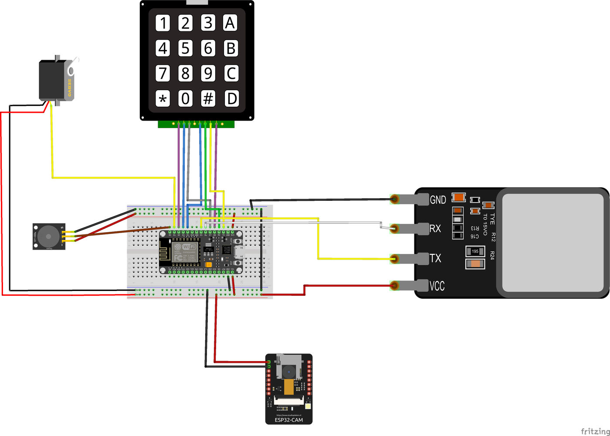

# SmartAccess

**A full-stack IoT access control system for homes:** fingerprint and PIN authentication at the door, remote unlock, live video monitoring, and household management from a web dashboard and a native mobile app.

Built end-to-end as my Bachelor's thesis, from wiring the hardware and writing the firmware to the REST API, the database, and both client apps.


<p align="center">
  
</p>

---

## Features

- **Biometric access.** Fingerprint enrollment and matching on the device at the door, with a decision in under a second.
- **PIN fallback.** A 4×3 matrix keypad with a configurable 4–8 digit PIN, stored in EEPROM, plus a lockout period after wrong attempts.
- **Remote unlock.** Open the door from the web dashboard or the mobile app.
- **Live video.** An MJPEG stream from an ESP32-CAM (~15–25 fps at QVGA), viewable in the browser and in the app.
- **Access history.** Every attempt (fingerprint, PIN, app or unknown) is logged with its result and timestamp.
- **Intrusion alerts.** Denied attempts trigger notifications to all active household members.
- **Household management.** Admin and user roles, email invitations with expiring single-use links, presence tracking ("home for 19 min"), and fingerprint enrollment orchestrated from the app.
- **Works offline.** Fingerprint and PIN access keep working when the server or internet is down. Events sync once the connection is back.

## Architecture

```
┌──────────────────────┐      ┌──────────────────────┐
│   Web client         │      │  Mobile app          │
│   HTML / CSS / JS    │      │  C# · .NET MAUI      │
└──────────┬───────────┘      └──────────┬───────────┘
           │        REST + JSON · JWT     │
           └──────────────┬───────────────┘
                ┌─────────▼─────────┐        ┌──────────────┐
                │  Backend          │◄──────►│  PostgreSQL  │
                │  Node.js/Express  │        └──────────────┘
                └───┬───────────┬───┘
       HTTP polling │           │ MJPEG stream
       (every 3 s)  │           │
          ┌─────────▼───┐   ┌───▼──────────┐
          │  ESP8266    │   │  ESP32-CAM   │
          │  access node│   │  video node  │
          └─────────────┘   └──────────────┘
   fingerprint sensor · keypad · servo lock · buzzer
```

The system has four layers, and each one talks only to its neighbours. Clients never talk to the hardware directly: every action goes through the authenticated backend, which is the single controlled entry point.

## Tech stack

| Layer | Technology | Responsibility |
|---|---|---|
| Access node | C++ (Arduino), ESP8266 | Fingerprint matching, PIN keypad, servo lock, buzzer, embedded HTTP server |
| Camera node | C++ (ESP-IDF), ESP32-CAM | MJPEG video streaming over HTTP |
| Backend | Node.js, Express, `pg`, `jsonwebtoken`, `bcryptjs`, `nodemailer` | REST API, auth, business logic, device sync, email invites |
| Database | PostgreSQL | Users, access events, notifications, invitations |
| Web client | HTML, CSS, vanilla JavaScript | Browser dashboard |
| Mobile client | C#, .NET 9 MAUI (Android, iOS, Windows) | Native app on the same API |

## Engineering highlights

- **Finite-state machine firmware.** The door node runs as an FSM (`Idle → PinEntry / Enroll → Unlocked / Denied`). Each transient state has its own timer, which handles auto re-locking and brute-force protection on the keypad.
- **Idempotent event sync.** The access node can't push to the server, so the backend polls its append-only log every 3 s (average detection latency 1.5 s) and processes only the new suffix. Device reboots and log truncation are handled by overlap detection, so events are never logged twice.
- **Pin multiplexing on a constrained MCU.** The ESP8266 has very few free GPIOs. The keypad uses the RX/TX pins and the fingerprint sensor uses software serial, with a custom keypad scanning routine.
- **Security model.**
  - Stateless JWT auth, re-checked against the database so disabled accounts are rejected immediately.
  - bcrypt password hashing.
  - Role-based access control enforced on the server (401/403).
  - Parameterized SQL queries.
  - Duplicate fingerprints are rejected at enrollment.
- **Graceful degradation.** Access decisions are made locally on the device, so the system's core function never depends on the network.

## Screenshots

| Dashboard | Live camera |
|---|---|
|  |  |
| **Access history** | **Members & presence** |
|  |  |

<details>
<summary><b>Wiring diagram</b> (Fritzing)</summary>



</details>

## Testing

The system was validated with functional, security and performance tests on the physical prototype:

| Area | Examples (all passing) |
|---|---|
| Functional | Enrolled / unknown fingerprint, correct / wrong PIN, remote unlock, enroll & delete fingerprint, email invite, live stream, local access with the server offline |
| Security | Tampered JWT → 401, regular user on admin route → 403, SQL injection neutralized, reused or expired invite rejected, repeated wrong PIN → lockout |
| Performance | Fingerprint recognition < 1 s, remote unlock ~1–2 s, history update ≤ 3 s, video ~15–25 fps |

## Project structure

```
├── ESP8266/                 # Access node firmware (fingerprint, keypad, servo, buzzer)
├── ESP32-CAM/               # Camera node firmware (MJPEG stream)
└── SmartAccess/
    ├── SmartAccess_Web/
    │   ├── server/          # Express API: routes, JWT middleware, DB, email
    │   │   ├── schema.sql   # Database schema
    │   │   └── seed.sql     # Initial admin account
    │   └── public/          # Web client
    └── SmartAccess_Mobile/  # .NET MAUI app
```

## Getting started

### Backend & web client
Requires Node.js 18+ and PostgreSQL.

```bash
cd SmartAccess/SmartAccess_Web
cp .env.example .env        # fill in DB credentials, JWT secret, device IPs, SMTP
npm install
npm run db:init             # creates the schema and the seed data
npm start                   # http://localhost:3000
```

Default admin account (from `seed.sql`): `admin@smartaccess.local` / `admin123`. Change it after the first login.

### Firmware
In both `ESP8266/` and `ESP32-CAM/`, copy `secrets.example.h` to `secrets.h` and set your WiFi credentials. Then flash with the Arduino IDE. The ESP8266 sketch needs the *Adafruit Fingerprint Sensor* library.

### Mobile app
Open `SmartAccess/SmartAccess.sln` in Visual Studio 2022 with the .NET MAUI workload installed. Set the server URL on the login screen.

## Hardware

ESP8266 (NodeMCU) · fingerprint sensor module (UART, Adafruit-compatible) · 4×3 matrix keypad · micro servo (FS90) · active buzzer · ESP32-CAM (AI Thinker)

---

*Bachelor's thesis, Technical University of Cluj-Napoca (2026). A paper based on this project was submitted to ICECER 2026.*
